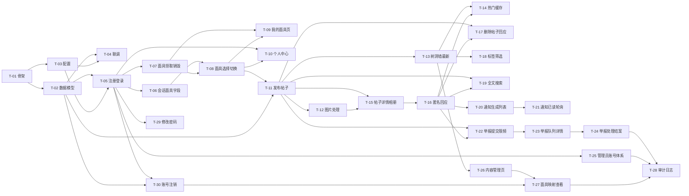

# 回声洞 · 开发任务卡片

> 依据《回声洞-软件需求规格说明书-v0.5.md》拆分。
> 仓库 `ammadyyy/ccnu_treehole` 当前为空仓库（仅 README），本清单为从零开始的开发拆解。

## 说明

- 任务按里程碑 **M1–M6** 分组，共 **34 张卡片**。
- 每张卡片含：任务 ID、标题、关联需求、描述、验收标准（DoD）、前置依赖。
- 前置依赖只指向「必须先完成才能开始本任务」的任务，不含「可并行但建议后做」的软依赖。
- 文末附依赖关系图（Mermaid）与依赖矩阵。

---

## 一、任务总览

| 里程碑 | 任务 | 标题 | 前置依赖 |
|---|---|---|---|
| M1 | T-01 | 项目骨架初始化 | — |
| M1 | T-02 | SQLite 数据模型与迁移 | T-01 |
| M1 | T-03 | 配置管理与数据目录 | T-01 |
| M1 | T-04 | 前后端开发联调 | T-01, T-02, T-03 |
| M2 | T-05 | 注册 / 登录 / 登出 | T-02, T-03 |
| M2 | T-06 | 会话与当前面具字段 | T-05 |
| M2 | T-07 | 面具领取 / 销毁 | T-05 |
| M2 | T-08 | 当前面具选择与切换 | T-06, T-07 |
| M2 | T-09 | 我的面具页 | T-07, T-08 |
| M2 | T-10 | 个人中心页 | T-05, T-08 |
| M3 | T-11 | 发布帖子 | T-08, T-02 |
| M3 | T-12 | 图片上传与处理 | T-11 |
| M3 | T-13 | 树洞墙最新列表 | T-11 |
| M3 | T-14 | 24 小时热门与缓存 | T-13 |
| M3 | T-15 | 帖子详情与相册 | T-11, T-12 |
| M3 | T-16 | 匿名回应 | T-15 |
| M3 | T-17 | 删除帖子与回应 | T-11, T-16 |
| M4 | T-18 | 标签筛选 | T-13 |
| M4 | T-19 | 全文搜索 | T-11, T-16 |
| M4 | T-20 | 通知生成与列表 | T-16 |
| M4 | T-21 | 通知已读与轮询 | T-20 |
| M5 | T-22 | 举报提交与限频 | T-11, T-16 |
| M5 | T-23 | 举报队列与详情 | T-22 |
| M5 | T-24 | 举报处理与结案 | T-23 |
| M5 | T-25 | 管理员账号体系 | T-05 |
| M5 | T-26 | 内容管理页 | T-13 |
| M5 | T-27 | 面具映射查看 | T-26, T-30 |
| M5 | T-28 | 审计日志 | T-24, T-25, T-27 |
| M5 | T-29 | 修改密码 | T-05 |
| M5 | T-30 | 账号注销 | T-05, T-02 |
| M6 | T-31 | 种子数据脚本 | M2–M5 全部 |
| M6 | T-32 | 生产部署（Waitress + systemd） | 全部功能, T-01, T-03 |
| M6 | T-33 | 备份与恢复脚本 | T-02, T-03 |
| M6 | T-34 | 全量验收测试 | 全部 |

---

## 二、里程碑与任务卡片

### M1 基础工程

#### T-01 项目骨架初始化
- **关联需求**：NFR-01, NFR-02, NFR-07
- **描述**：建立 `backend/`（Flask）与 `frontend/`（Vite + React + TS）双目录，配好包管理器、`.gitignore`、`.env.example`、README 骨架与统一代码风格配置。
- **验收标准**：
  - 前后端分别可启动；
  - `.env.example` 列出全部配置键；
  - `git init` 后能提交，`node_modules`、`venv`、`data/`、`uploads/` 均被忽略；
  - README 写明项目结构与启动命令。
- **前置依赖**：无

#### T-02 SQLite 数据模型与迁移
- **关联需求**：FR-01~FR-15（数据模型第 6 章）
- **描述**：建立全部 11 张表 + `posts_fts`/`comments_fts` 虚表；实现编号化迁移机制（`migrations/00x_*.sql` + 应用启动时自动应用）。
  - 表：`users`、`sessions`、`masks`、`posts`、`comments`、`images`、`notifications`、`reports`、`report_notes`、`audit_log`、`sensitive_words`（预留）。
  - 关键字段：`users.deleted_email`、`sessions.current_mask_id`、`posts.title/status/deleted_at`、`notifications.comment_id/comment_deleted`、`reports.reporter_email_snapshot/reporter_ip/handled_reason/handled_detail`。
- **验收标准**：
  - 空库可一键迁移到最新 schema；
  - FTS5 虚表以 `tokenize=trigram` 创建；
  - 唯一约束：`users.email`（活动）、`masks.token`；
  - 外键启用 `PRAGMA foreign_keys=ON`。
- **前置依赖**：T-01

#### T-03 配置管理与数据目录
- **关联需求**：NFR-02, NFR-07
- **描述**：实现从 `.env` 读取 `APP_ENV/APP_URL/HOST/PORT/DATA_DIR/DATABASE_PATH/UPLOAD_DIR/COOKIE_SECURE`，并提供统一的配置访问入口；启动时确保 `DATA_DIR` 与 `UPLOAD_DIR` 存在。
- **验收标准**：
  - 缺少 `.env` 时给出明确提示或使用安全的开发默认值；
  - 数据库、图片路径完全由配置决定，代码无硬编码绝对路径；
  - 修改 `PORT` 后服务监听端口随之变化。
- **前置依赖**：T-01

#### T-04 前后端开发联调
- **关联需求**：NFR-01
- **描述**：Vite dev server 将 `/api/*` 代理到 Flask；提供 `GET /api/health`；打通本地开发循环。
- **验收标准**：
  - 前端 `fetch('/api/health')` 返回 200；
  - 生产构建产物可由 Flask 同源静态服务提供（为 T-32 铺垫）。
- **前置依赖**：T-01, T-02, T-03

---

### M2 账号与面具

#### T-05 注册 / 登录 / 登出
- **关联需求**：FR-01, FR-02
- **描述**：邮箱+密码注册（无验证码）、登录、登出；Werkzeug PBKDF2 哈希；httpOnly + SameSite=Lax Cookie 会话；密码强度校验（≥8 位且含字母数字）。
- **验收标准**：
  - 新邮箱可注册，弱密码被拒，重复邮箱被拒；
  - 登出后会话销毁；
  - 登录页「忘记密码」点击显示「开发中……敬请期待」；
  - 密码明文不出现在数据库、接口或日志。
- **前置依赖**：T-02, T-03

#### T-06 会话与当前面具字段
- **关联需求**：FR-05
- **描述**：`sessions.current_mask_id` 读写逻辑；登录时为 NULL；服务端以该字段为准，不信任前端提交的面具 ID。
- **验收标准**：
  - 刷新/跨页后当前面具保持不变；
  - 服务端能读取当前面具用于发帖/回应；
  - 销毁当前面具后字段清空。
- **前置依赖**：T-05

#### T-07 面具领取 / 销毁
- **关联需求**：FR-03, FR-04
- **描述**：随机面具生成（`匿名者·` + 4 位剔除易混字符的小写串，全局唯一、永久不复用）；每人最多 5 个可用面具；销毁需弹窗确认；销毁后面具状态为 `destroyed`，历史内容保留。
- **验收标准**：
  - 领取后格式匹配 `^匿名者·[a-z2-9]{4}$`；
  - 第 6 个可用面具领取被拒；
  - 销毁后不可再用于发帖/回应；
  - 面具名永久不复用。
- **前置依赖**：T-05

#### T-08 当前面具选择与切换
- **关联需求**：FR-05
- **描述**：登录后强制选择面具；个人中心点击当前面具展开列表切换；我的面具页「设为当前」；切换更新 `sessions.current_mask_id`，历史内容不变。
- **验收标准**：
  - 无面具时不能发帖/回应，并引导领取；
  - 切换后新帖新回应使用新面具；
  - 已销毁面具不出现在可切换列表。
- **前置依赖**：T-06, T-07

#### T-09 我的面具页
- **关联需求**：FR-03, FR-04, FR-05
- **描述**：`/me/masks` 页：可用面具列表（设为当前、销毁）、已销毁面具分组（查看/删除历史帖子）、领取按钮（含确认弹窗）。
- **验收标准**：
  - 可用/已销毁分组正确；
  - 已销毁面具的历史帖子可查看、可删除；
  - 销毁确认弹窗显示「历史内容仍保留」与帖子/回应数。
- **前置依赖**：T-07, T-08

#### T-10 个人中心页
- **关联需求**：FR-15, 导航（默认决策第 5–6 条）
- **描述**：`/me` 页：账号邮箱、当前面具（可点击切换）、面具数量、我的面具入口、我的帖子入口、账号设置入口、退出登录（需确认）。
- **验收标准**：
  - 邮箱仅本人可见；
  - 退出登录有确认弹窗；
  - 管理员额外显示「管理后台」入口（为 T-25 预留）。
- **前置依赖**：T-05, T-08

---

### M3 核心内容链路

#### T-11 发布帖子
- **关联需求**：FR-06
- **描述**：`POST /api/posts`（multipart 或分离结构）：标题（1–50，单行）、正文（1–2000）、标签（1–2 个固定标签）；使用当前面具；账号级 30 秒限速。
- **验收标准**：
  - 标题/正文超长被拒并给中文提示；
  - 标签 0 个或 3 个被拒；
  - 30 秒内第二帖返回 429；
  - 发布成功后进入详情/树洞墙。
- **前置依赖**：T-08, T-02

#### T-12 图片上传与处理
- **关联需求**：FR-07
- **描述**：发布时与正文一起上传；魔数校验；EXIF 方向校正后剥离全部元数据；静态图转 WebP（q85），GIF/动画 WebP 转动画 WebP；生成缩略图（动画缩略图仅第一帧）；原始上传 ≤5MB、静态成品 ≤5MB、动画成品 ≤10MB、缩略图 ≤1MB；随机 UUID 文件名；`images.sort_order`、`caption`。
- **验收标准**：
  - `.exe` 改名 `.jpg` 被拒；
  - 6MB 静态图被拒，9MB 动画可上传；
  - 成品无 EXIF、格式为 WebP；
  - 取消发帖后 `uploads/` 无新增文件。
- **前置依赖**：T-11

#### T-13 树洞墙最新列表
- **关联需求**：FR-08
- **描述**：`GET /api/posts?sort=latest&tag=&cursor=`；`created_at + id` 游标，每次 20 条；卡片展示标题、第一张缩略图（右下角数量角标）、正文摘要（140 字）、面具、标签、回应数、相对时间；整卡点击进详情。
- **验收标准**：
  - 20 条/页，滚动加载无重复无遗漏；
  - 卡片顺序为「标题 → 缩略图 → 摘要 → 元信息」；
  - 已删除/墓碑帖子不出现在列表。
- **前置依赖**：T-11

#### T-14 24 小时热门与缓存
- **关联需求**：FR-08
- **描述**：`GET /api/posts/hot?tag=` 或 `sort=hot`；按最近 24h 公开回应数降序（同数按发布时间倒序），只取前 20 条；全站 + 7 标签共 8 份进程内缓存，5 分钟刷新，过期先返旧缓存再后台刷新；刷新失败保留旧值并记日志。
- **验收标准**：
  - 冷启动能返回结果；
  - 标签筛选命中对应缓存；
  - 新增回应后 5 分钟内排名可能不变，5 分钟后刷新；
  - 完整热度统计依赖 T-16 的回应数据。
- **前置依赖**：T-13（完整热度依赖 T-16）

#### T-15 帖子详情与相册
- **关联需求**：FR-09
- **描述**：`GET /api/posts/:id`；详情页布局：标题 → 横向相册（图片在正文上方，最大高 60vh、不裁剪、桌面按钮/键盘、移动端区域内滑动、预加载相邻图、点击开大图弹窗）→ 正文 → 操作栏 → 回应区；页面自然滚动。
- **验收标准**：
  - 相册单图高 ≤60vh、不裁剪；
  - 桌面键盘左右切换、移动端滑动切换；
  - 大图弹窗支持缩放/拖动/下载、显示图片说明；
  - 返回时恢复进入前滚动位置与筛选状态。
- **前置依赖**：T-11, T-12

#### T-16 匿名回应
- **关联需求**：FR-09, FR-12
- **描述**：`POST /api/posts/:id/comments`；单层回应，1–500 字；使用当前面具；账号级 30 秒限速；同帖可切换面具；发帖面具回应标「楼主」；发布后定位到新回应；详情页 30 秒检查新回应、显示「有 N 条新回应」。
- **验收标准**：
  - 501 字被拒；
  - 30 秒内第二回应返回 429；
  - 同账号换面具回应不显示「楼主」；
  - 回应列表滚动加载、定位新回应。
- **前置依赖**：T-15

#### T-17 删除帖子与回应
- **关联需求**：FR-10, NFR-04
- **描述**：删除帖子先提交数据库事务（清空正文/标题/标签/面具关联、删回应、删图片记录、置 `status=deleted`+`deleted_at`，保留墓碑），提交后再删磁盘文件；文件删除失败只记日志不回滚；删除回应同步减回应数、通知标「回应已删除」。
- **验收标准**：
  - 已销毁面具历史帖可由原账号删除；
  - 删除后旧 URL 返回不存在；
  - 数据库无正文残留、磁盘无文件残留；
  - 通知保留「内容已删除」占位。
- **前置依赖**：T-11, T-16

---

### M4 搜索与通知

#### T-18 标签筛选
- **关联需求**：FR-08
- **描述**：树洞墙顶部单标签筛选；与最新/热门、搜索组合使用。
- **验收标准**：
  - 选中标签后仅显示该标签帖子；
  - 空结果显示空状态。
- **前置依赖**：T-13

#### T-19 全文搜索
- **关联需求**：FR-11
- **描述**：`GET /api/search?q=&tag=&cursor=`；单/双字用参数化 `LIKE`，三字及以上用 FTS5 trigram；覆盖标题、正文、回应；结果按帖聚合、每帖一条、按发布时间倒序；不高亮。
- **验收标准**：
  - 搜「图」命中「图书馆」；
  - 搜「图书馆」走 trigram 且结果不重复；
  - 关键词含引号/分号不报错、不改变语义；
  - 已删除/墓碑内容不出现。
- **前置依赖**：T-11, T-16

#### T-20 通知生成与列表
- **关联需求**：FR-12
- **描述**：他人回应我的帖子时生成一条通知；自己回应自己不发；每条回应一条，不合并；归属账号；显示触发面具与帖子标题；`post_id` 关联墓碑。
- **验收标准**：
  - 跨账号回应生成通知，自回应不生成；
  - 帖子删除后通知显示「内容已删除」，不显示正文；
  - 回应删除后通知显示「回应已删除」；
  - 通知永久保留、不做过期清理。
- **前置依赖**：T-16

#### T-21 通知已读与轮询
- **关联需求**：FR-12
- **描述**：`/me/notifications`：未读红点与数量（>99 显示 99+）、逐条已读、全部已读（需确认）；导航 30 秒轮询 + 页面聚焦时刷新；滚动加载。
- **验收标准**：
  - 仅打开列表不清空未读；
  - 点击单条立即标已读并跳转；
  - 全部已读需二次确认；
  - 返回列表恢复滚动位置。
- **前置依赖**：T-20

---

### M5 举报、管理员与账号设置

#### T-22 举报提交与限频
- **关联需求**：FR-13
- **描述**：`POST /api/reports`；仅登录用户；固定原因 + 可选说明（≤200 字）；同一用户可重复举报但每分钟最多 3 次；不自动隐藏内容；记录 `reporter_email_snapshot`、`reporter_mask_id`、`reporter_ip`。
- **验收标准**：
  - 游客调用返回 401；
  - 一分钟第 4 次返回 429；
  - 不能举报自己的内容；
  - 已删除目标拒绝举报。
- **前置依赖**：T-11, T-16

#### T-23 举报队列与详情
- **关联需求**：FR-13, FR-14
- **描述**：`/admin/reports` 队列：按待处理数降序（同数按最新待处理时间升序）；原因/状态筛选；详情页展示全部举报记录（旧→新）、被举报内容上下文、内部备注（新→旧）。
- **验收标准**：
  - 队列排序与筛选正确；
  - 详情可查看帖子/回应上下文；
  - 举报者邮箱、举报时面具、举报 IP 对管理员可见。
- **前置依赖**：T-22

#### T-24 举报处理与结案
- **关联需求**：FR-13, FR-14
- **描述**：`POST /api/admin/reports/:id/resolve`：保留/删除；删除需固定理由 + ≥10 字说明 + 二次确认；同目标未处理举报统一结案；`report_notes` 可多次追加、不可改删；结案不通知举报者与作者。
- **验收标准**：
  - 删除后不可恢复，写审计日志；
  - 理由缺失/说明不足 10 字被拒；
  - 保留后同目标举报统一结案；
  - 用户已自行删除则标「目标已删除」不可再处理。
- **前置依赖**：T-23

#### T-25 管理员账号体系
- **关联需求**：FR-14
- **描述**：唯一超级管理员 + 普通管理员；初始化脚本创建超级管理员；超级管理员可创建/停用/重置普通管理员（需理由+确认）；停用后邮箱继续绑定原账号、只可恢复；普通管理员不能管理管理员。
- **验收标准**：
  - 注册接口不能提权；
  - 普通管理员访问管理员管理接口返回 403；
  - 停用后目标全部会话立即失效；
  - 停用邮箱不能用于创建新管理员。
- **前置依赖**：T-05

#### T-26 内容管理页
- **关联需求**：FR-14
- **描述**：`/admin/content`：关键词搜索（单字起）、「全部/仅帖子/含回应」筛选、已注销面具筛选、时间范围筛选；列表可展开回应、直接删除帖子/回应（走 T-24 同款理由+确认+审计）。
- **验收标准**：
  - 默认按发布时间倒序、滚动加载；
  - 已注销面具内容可筛选并标注命中原因；
  - 删除均需理由、确认、审计。
- **前置依赖**：T-13

#### T-27 面具映射查看
- **关联需求**：FR-14
- **描述**：管理员查看面具对应账号信息（邮箱、注册时间、最后登录时间/IP/UA、面具列表）；普通面具查看不记日志，已注销面具查看记日志（含来源页、管理员 IP）。
- **验收标准**：
  - 普通用户不可见映射入口；
  - 查看普通面具不新增审计日志；
  - 查看已注销面具新增审计日志且含来源页与 IP。
- **前置依赖**：T-26, T-30

#### T-28 审计日志
- **关联需求**：FR-14
- **描述**：`audit_log` 记录删除内容、处理举报、创建/停用管理员、重置密码、查看已注销面具映射；只读、不导出；普通管理员只看自己，超级管理员看全部；支持时间/操作类型/管理员筛选。
- **验收标准**：
  - 日志不可修改、删除、导出；
  - 普通管理员看不到超级管理员记录；
  - 敏感操作均产生日志。
- **前置依赖**：T-24, T-25, T-27

#### T-29 修改密码
- **关联需求**：FR-15
- **描述**：`POST /api/me/password`：当前密码 + 新密码（强度同注册）+ 确认；成功后保留当前会话、注销其他会话。
- **验收标准**：
  - 旧密码错误被拒；
  - 改后当前会话有效、其他会话失效；
  - 新密码可登录。
- **前置依赖**：T-05

#### T-30 账号注销
- **关联需求**：FR-15
- **描述**：`POST /api/me/delete`：输入密码 + 二次确认；注销后 `email` 置空、原值写入 `deleted_email`、写 `deleted_at`；历史内容保留、公开身份统一「已注销面具」；通知删除；原邮箱可重新注册且与旧账号隔离。
- **验收标准**：
  - 注销后无法登录；
  - 历史帖子显示「已注销面具」、图片保留；
  - 通知已删除；
  - 原邮箱可注册新账号，旧内容仍「已注销面具」。
- **前置依赖**：T-05, T-02

---

### M6 演示准备

#### T-31 种子数据脚本
- **关联需求**：D18（演示数据）
- **描述**：seed 脚本创建测试账号、面具、帖子、回应、管理员与敏感词数据。
- **验收标准**：
  - 可重复执行且幂等；
  - 生成 60 帖/约 200 回应量级；
  - 创建超级管理员账号。
- **前置依赖**：M2–M5 全部

#### T-32 生产部署（Waitress + systemd）
- **关联需求**：NFR-01
- **描述**：LXC（Debian 12）内用 Waitress 承载 Flask + 静态前端，systemd 托管、崩溃自启；数据目录独立；`APP_URL` 配置访问地址。
- **验收标准**：
  - `systemctl` 启停正常、开机自启；
  - 重启后数据库与图片仍存在；
  - 校园网另一设备可用 IP+端口访问。
- **前置依赖**：全部功能, T-01, T-03

#### T-33 备份与恢复脚本
- **关联需求**：NFR-02
- **描述**：备份数据库 + `uploads/`；恢复脚本；附使用说明。
- **验收标准**：
  - 备份包可在干净环境恢复；
  - 恢复后账号、帖子、图片、通知可用。
- **前置依赖**：T-02, T-03

#### T-34 全量验收测试
- **关联需求**：UC-01~UC-13, NFR
- **描述**：走通全部用例与演示动线；核对限速、权限、删除一致性、图片处理、审计日志等验收点。
- **验收标准**：
  - 13 条用例主流程 + 关键异常流程通过；
  - 演示动线 12 步可复现；
  - NFR-03/04/05 关键项达标。
- **前置依赖**：全部

---

## 三、依赖关系图



---

## 四、依赖矩阵（行依赖列）

| 任务 | 依赖 |
|---|---|
| T-01 | — |
| T-02 | T-01 |
| T-03 | T-01 |
| T-04 | T-01, T-02, T-03 |
| T-05 | T-02, T-03 |
| T-06 | T-05 |
| T-07 | T-05 |
| T-08 | T-06, T-07 |
| T-09 | T-07, T-08 |
| T-10 | T-05, T-08 |
| T-11 | T-08, T-02 |
| T-12 | T-11 |
| T-13 | T-11 |
| T-14 | T-13（完整热度 T-16） |
| T-15 | T-11, T-12 |
| T-16 | T-15 |
| T-17 | T-11, T-16 |
| T-18 | T-13 |
| T-19 | T-11, T-16 |
| T-20 | T-16 |
| T-21 | T-20 |
| T-22 | T-11, T-16 |
| T-23 | T-22 |
| T-24 | T-23 |
| T-25 | T-05 |
| T-26 | T-13 |
| T-27 | T-26, T-30 |
| T-28 | T-24, T-25, T-27 |
| T-29 | T-05 |
| T-30 | T-05, T-02 |
| T-31 | M2–M5 全部 |
| T-32 | 全部功能, T-01, T-03 |
| T-33 | T-02, T-03 |
| T-34 | 全部 |

---

## 五、并行建议

以下任务之间无硬依赖，可在相应里程碑内并行：

- **M1**：T-02 与 T-03 可并行（均仅依赖 T-01）。
- **M2**：T-07 与 T-06 可并行（均仅依赖 T-05）；T-09 与 T-10 可并行。
- **M3**：T-12、T-13、T-15 在 T-11 完成后可并行推进。
- **M4**：T-18 与 T-19 可并行；T-20 可先于 T-19 开始。
- **M5**：T-25、T-29、T-30 可与 T-22~T-24 主线并行；T-26 可与举报主线并行。

**关键路径**（建议优先保障）：

```text
T-01 → T-02 → T-05 → T-06 → T-08 → T-11 → T-15 → T-16 → T-22 → T-23 → T-24 → T-28
```

这条路径上的任何延迟都会直接影响最终交付时间。
